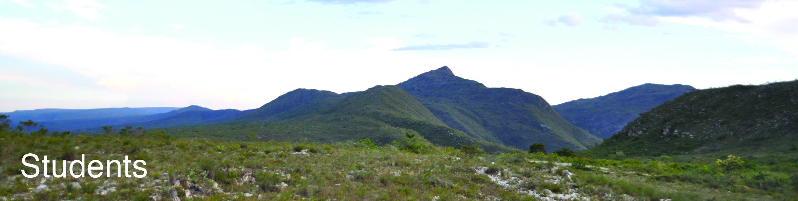
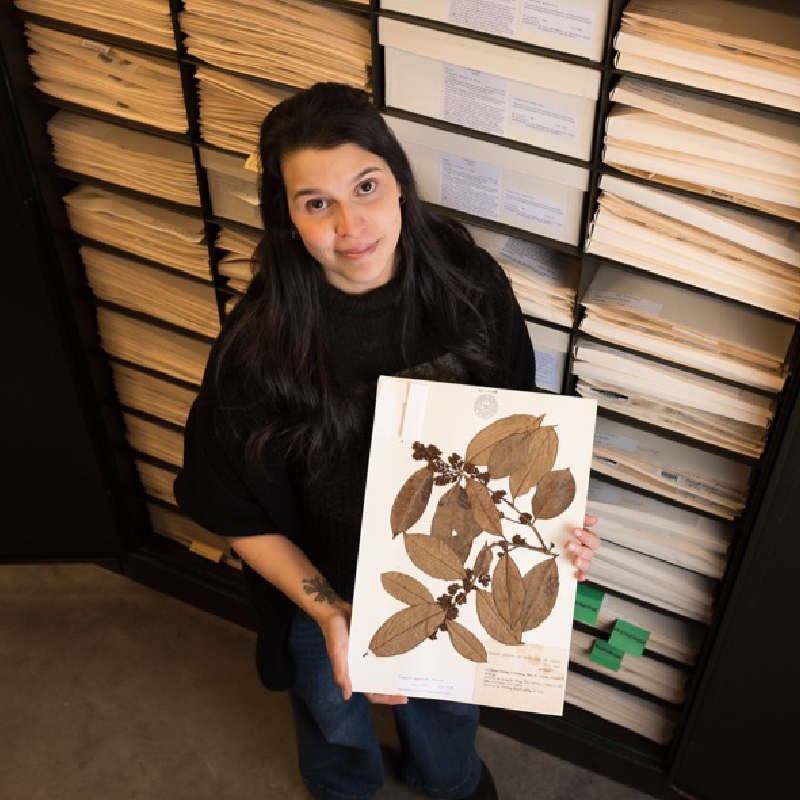
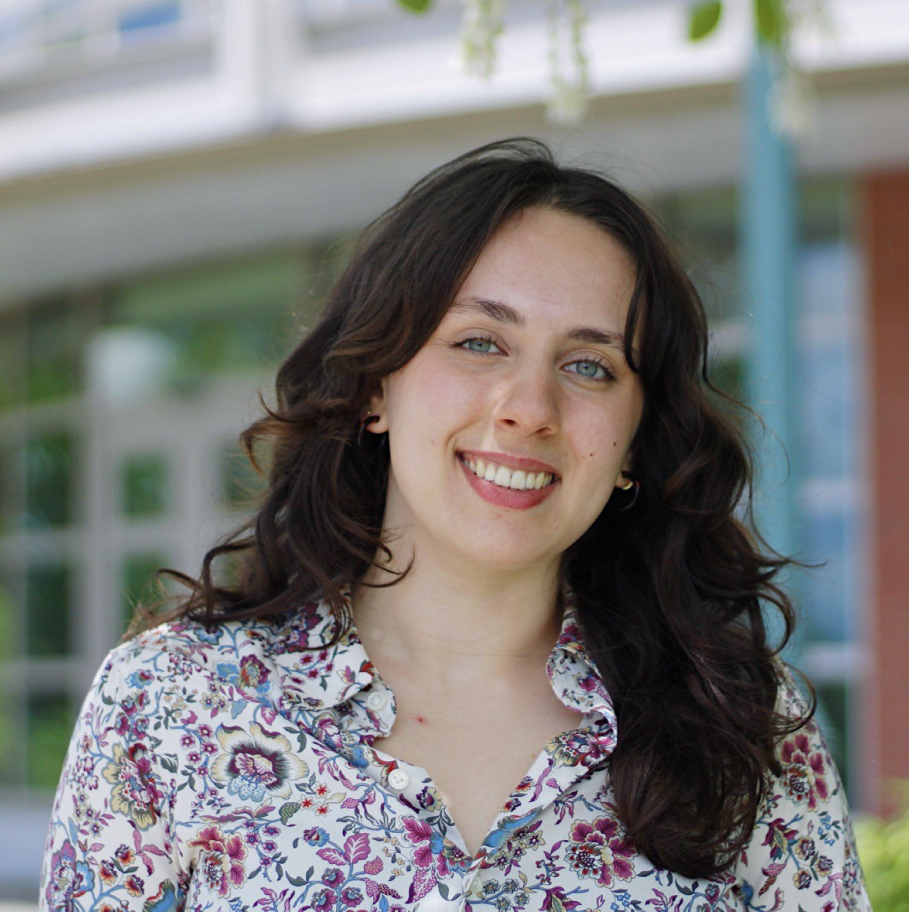
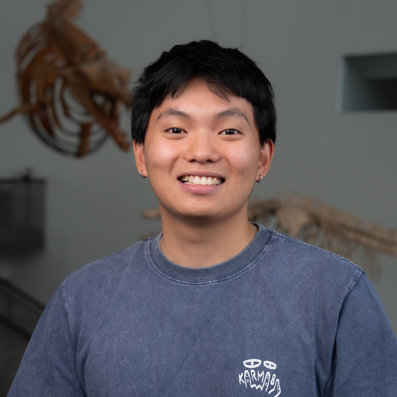
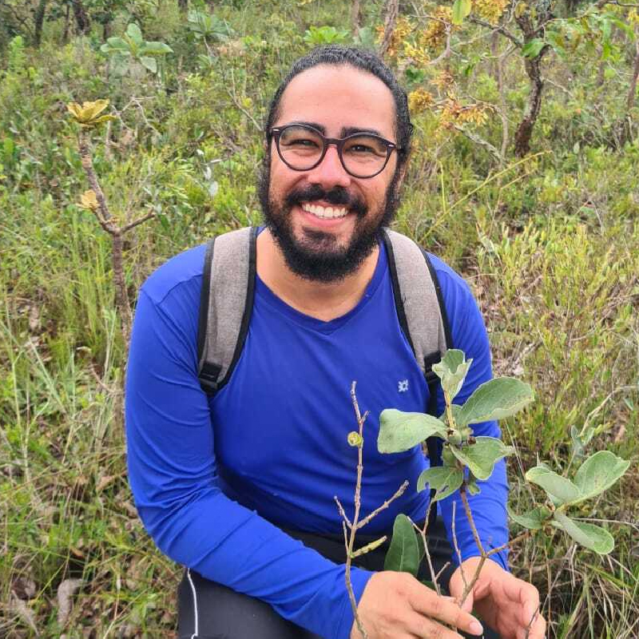

  

    
  
  
 The lab   
  
  
  

  

{}  
  
Thais Vasconcelos, PhD  
(Principal Investigator)  
The foundation of my research is to seek generalities, or “rules”, in flowering plant evolution, by focusing on the major biogeographical patterns observed in their phenotypes. (my first name is pronounced "tah-EES") <a href="TVasconcelos_CV_Aug2026.pdf#" class="download" style="color:blue" title="Download CV as PDF">CV here</a>	 tvasc@umich.edu  | [Thais' GitHub](https://github.com/tncvasconcelos) | [Thais' bluesky](https://bsky.app/profile/tvasconcelos.bsky.social) | [Thais' Google scholar](https://scholar.google.com/citations?user=bpkWIywAAAAJ&hl=en&oi=ao) 
  

  

{}  
  
Lena Heinrich  
(PhD student)   
Lena is broadly interested in plant-pollinator interactions, evolution, and behavioral ecology. Her work aims to explore the ecological and evolutionary drivers of functional and life history trait variation in bees and investigate how these traits mediate interactions between bees and plants across different environments. lenarh@umich.edu
  

  

{}  
  
Paulo Henrique Gaem, MSc  
(PhD student)  
Paulo is interested in systematics and evolution of highly diverse tropical plant lineages. His work aims to investigate the relationship between traits and the environment, phylogenetic relationships, biogeography, and trait divergence between sister taxa in neotropical myrtles (Myrtaceae, Myrteae), a hyper-diverse and
 morphologically homogeneous lineage. phgaem@umich.edu | [Paulo's Research Gate](https://www.researchgate.net/profile/Paulo-Henrique-Gaem) | [Paulo's Google scholar](https://scholar.google.com/citations?user=0mWvvX0AAAAJ&hl=pt-BR)
  

  
  

    

{}  
Dylan Sheng  
(PhD student)  
Dylan is interested in how species originate, how they got to where they are today, and the processes that generate new species. He is interested in utilizing herbarium collections, field work, and molecular data to answer these questions. dylsheng@umich.edu 
  

  
  
  

 
{}  
Lázaro Conceição, PhD   
(Postdoctoral Fellow)  
Lázaro is interested in the systematics, biogeography, and evolution of Myrtaceae. His research focuses on species delimitation within highly diverse and taxonomically complex tropical plant lineages, using Neotropical myrtles as a model system. To address this, he is building a robust phylogenomic framework for a target clade within the group. lconceic@umich.edu | [Lázaro's Research Gate](https://www.researchgate.net/profile/Lazaro-Henrique-Soares-De-Moraes-Conceicao) | [Lázaro's Google scholar](https://scholar.google.com.br/citations?hl=pt-BR&user=ssa6ZV4AAAAJ)
  

  

{}  
  
  

  

{}  
  

{}  

  

{}  
  

  

  

{}  
  

  

  

{}  
  
  
 
  

  

  

   

  
   

  

{ width=100% }  

  

  

 Past members:   

 
  
2025-2026: Eric Hagen, postdoc (UM-EEB).  
2021-2026: Patrícia Sperotto, co-mentored PhD student (UFRGS, Brazil).  
2023-2026: Yacov Kilsztajn, co-mentored MSc student (UFRN, Brazil).  
2023-2025: Sandra Reinales, co-mentored PhD student (USP, Brazil).  
2024-2025: Ari Hoffman, undergraduate student (UM-EEB).  
2023-2025: Aline Martins, postdoc (UM-EEB).   
2024-2025: Aya Mortada, visiting PhD student (Unimore, Italy).  
2023,2024: Zoe Bugnaski, undergraduate student (UM-EEB).  
2023-2024: Milena Telhe, visiting PhD student (UFSCar, Brazil).  
2022-2024: Hercilia Freitas da Cunha, co-advised MS student (UFRN, Brazil).  
2020-2024: Thiago Fernandes, co-advised PhD student (JBRJ, Brazil).  
2023: Jonathan Sarasa, undergraduate student (UM-EEB).  
2023: Dahlia Rose, undergraduate student (UM-EEB).  
2023: Natalie Neumann, undergraduate student (UM-EEB).  
2023: Emily Lancaster, undergraduate student (UM-EEB).  
2019-2023: Lilian Melo, co-advised PhD student (UFU, Brazil).  
2018-2020: Raquel Pizzardo, undergraduate student (USP, Brazil).  
2018-2020: Mirian Antonicelli, undergraduate student (USP, Brazil).  
  
  

    
  

